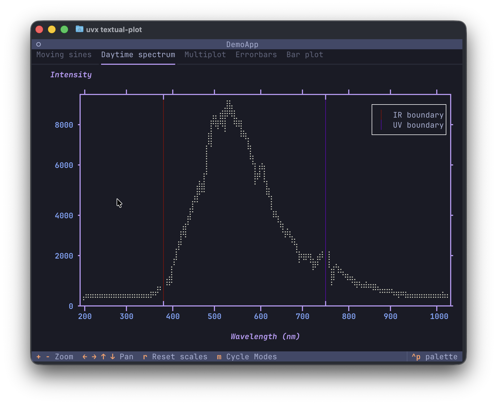

# Text-based user interfaces

De text-based user intefaces (TUI) of terminal user interface zijn oorspronkelijk de voorlopers van de graphical user interfaces die wel nog in een terminal worden uitgevoerd. Een populair framework waarmee je in Python een TUI kunt bouwen is [Textual](https://textual.textualize.io). Dit framework is recent ontwikkeld omdat TUIs weer steeds populairder worden. Grafische applicaties zijn mooi en handig, maar vaak ook groot, tijdrovend om te ontwikkelen en zijn vaak traag als ze niet op je eigen computer draaien, maar op een computer ergens op het internet (denk aan remote-desktop oplossingen).



Vraag maar eens rond: aardig wat van de TA's op de zaal hebben ervaring met het draaien van berekeningen of simulaties op een computercluster van bijvoorbeeld het Nikhef. Je opent een terminal, logt in op een andere computer met SSH, en draait dan je code vanuit die terminal. Dat is dan bijna altijd een script of een command-line interface applicatie. Of... een TUI.

Eén van de voordelen van een TUI is dat als je toch in de terminal bezig bent, met je vingers op het toetsenbord, dat je de TUI heel snel kunt bedienen zonder dat je naar een muis of trackpad hoeft te grijpen. Dat blijkt dan vaak sneller. Maar: het _kan_ vaak wel, wat vooral handig is als je een applicatie nog niet zo goed kent.

Als je een TUI maakt voor het pythondaq experiment, dan wil je wel graag kunnen plotten. Een goede oplossing voor Textual is [textual-plot](https://davidfokkema.github.io/textual-plot/). Hiermee kun je scatterplots maken met error bars waarbij je met de muis kunt zoomen en schuiven. Je kunt een demo runnen met:
```console
uvx textual-plot
```

???+ opdracht-meer "Textual installeren"
    Maak een nieuw project aan om te oefenen met Textual en installeer de benodigdheden. Zie voor meer informatie de [documentatie](https://textual.textualize.io/getting_started/).

???+ opdracht-meer "Stopwatch" 
    Volg de [tutorial van Textual](https://textual.textualize.io/tutorial/) om een stopwatch applicatie te maken.

???+ opdracht-meer "Pythondaq: TUI"
    Nu je Textual beter kent, maak in je bestaande pythondaq project met behulp van Textual een TUI voor Pythondaq.